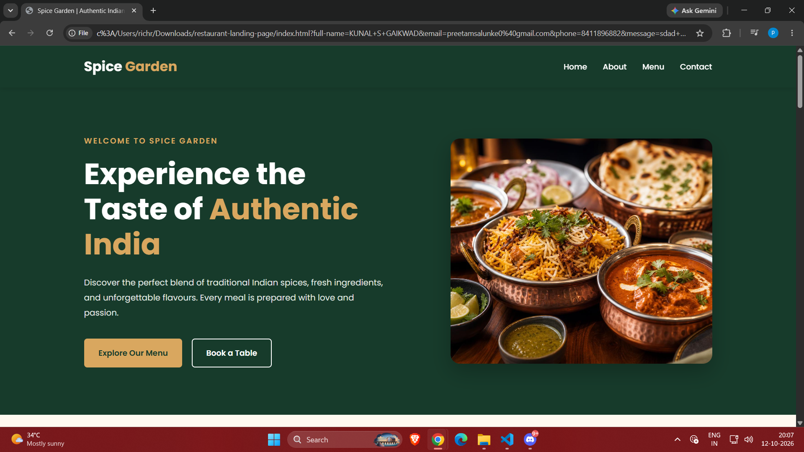
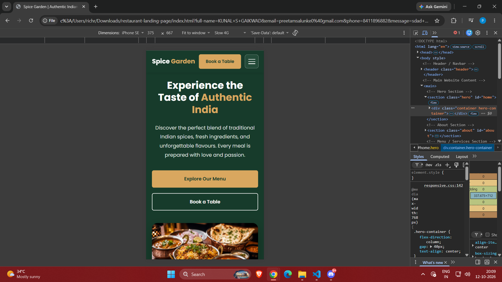
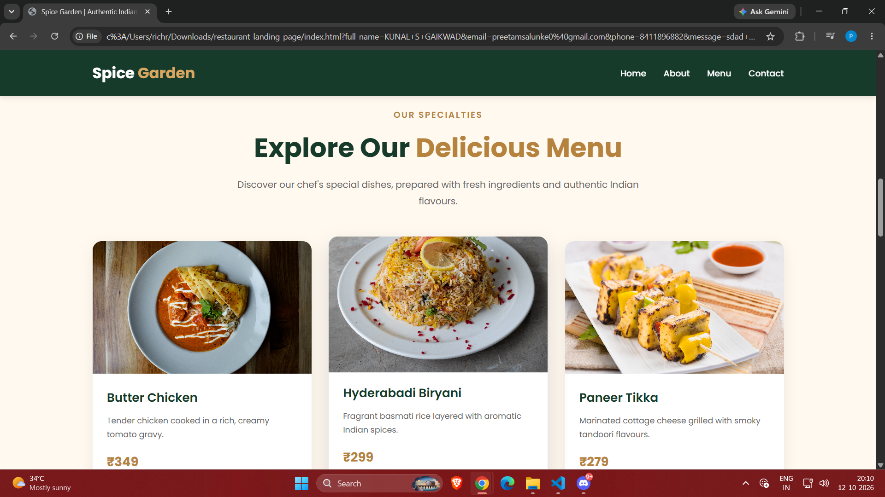
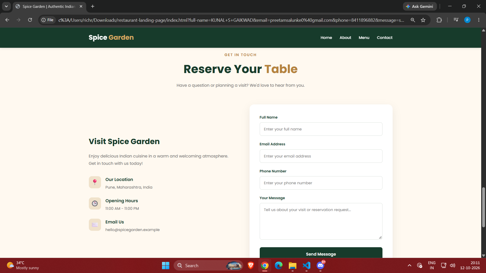

# Spice Garden Restaurant Landing Page

A modern, responsive restaurant landing page created as part of the **Web Development Internship – Week 1, Task 2** at **WeIntern Pvt Ltd**.

The website showcases an Indian restaurant with an attractive hero section, food menu, restaurant information, and an interactive contact form.

## Project Overview

**Spice Garden** is a fictional Indian restaurant website designed to provide visitors with a clean, engaging, and mobile-friendly browsing experience.

The project focuses on responsive layouts, accessible navigation, attractive UI design, and frontend form validation.

## Features

- Responsive design for desktop, tablet, and mobile
- Sticky navigation bar
- Mobile hamburger menu
- Hero section with call-to-action buttons
- About Us section
- Six featured Indian dishes with prices
- Why Choose Us feature cards
- Contact and reservation enquiry form
- HTML5 form validation
- Interactive demo success popup
- Smooth scrolling navigation
- Hover and focus effects
- Clean and modular CSS architecture

## Technologies Used

- HTML5
- CSS3
- JavaScript (Vanilla JS)
- CSS Flexbox
- CSS Grid
- Google Fonts
- Chrome DevTools

## Website Sections

### 1. Navigation Bar
Responsive navigation with Home, About, Menu, Contact, and Book a Table links.

### 2. Hero Section
Restaurant introduction, featured food image, and call-to-action buttons.

### 3. About Us
Information about the restaurant, its cuisine, and dining experience.

### 4. Food Menu
Six featured dishes:

- Butter Chicken
- Hyderabadi Biryani
- Paneer Tikka
- Dal Makhani
- Garlic Naan
- Gulab Jamun

### 5. Why Choose Us
Highlights fresh ingredients, experienced chefs, and a cozy atmosphere.

### 6. Contact Section
Restaurant contact details and an enquiry form with required-field validation.

**Note:** The form is a frontend demonstration. Submissions are not sent to a server, and no table reservations are confirmed.

## Project Structure

```text
restaurant-landing-page/
├── index.html
├── css/
│   ├── style.css
│   ├── navbar.css
│   ├── hero.css
│   ├── about.css
│   ├── menu.css
│   ├── why-choose-us.css
│   ├── contact.css
│   ├── footer.css
│   └── responsive.css
├── js/
│   └── script.js
├── assets/
│   └── images/
├── screenshots/
│   ├── landing-desktop.png
│   ├── landing-hero-mobile.png
│   ├── landing-services.png
│   └── landing-contact-form.png
└── README.md
```

## Screenshots

### Desktop Landing Page



### Mobile Hero Section



### Food Menu



### Contact Form



## How to Run Locally

1. Download or clone the repository.
2. Open the project folder in VS Code.
3. Open `index.html` in your browser.
4. Alternatively, use the VS Code Live Server extension.

No backend, package installation, or build process is required.

## Responsive Design

The website uses CSS media queries to adapt to different screen sizes.

- Desktop: Full navigation and multi-column layouts
- Tablet: Adjusted spacing and two-column menu grid
- Mobile: Hamburger navigation and single-column layouts

## Live Website

Live URL: To be added after deployment.

## GitHub Repository

Repository URL: To be added after uploading to GitHub.

## Author

**Preetam Gorakhnath Salunke**

Web Development Intern  
WeIntern Pvt Ltd

## Internship Details

- Organization: WeIntern Pvt Ltd
- Internship: Web Development
- Assignment: Week 1
- Task: Task 2 – Responsive Business Landing Page

## Disclaimer

Spice Garden is a fictional restaurant created for educational and portfolio purposes. The website does not accept real bookings or process contact form submissions.
